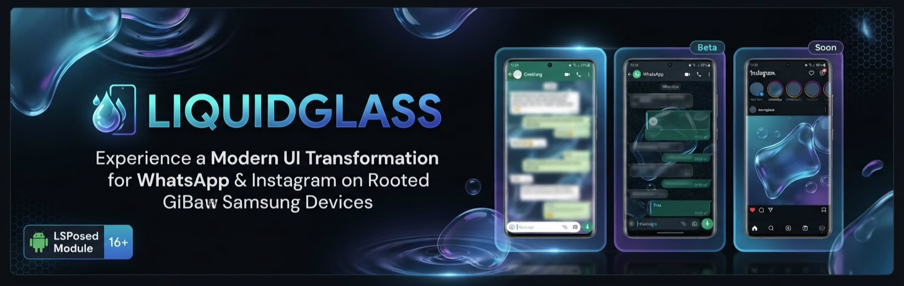
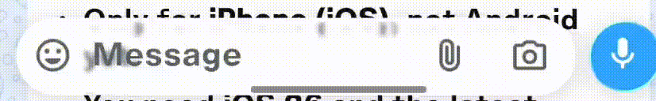
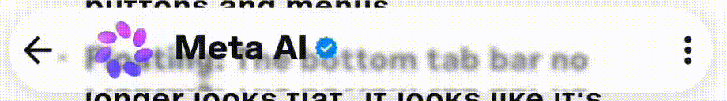

​<!-- PROJECT LOGO / BANNER PLACEHOLDER -->

​LiquidGlass for WhatsApp & Instagram (LSPosed Module)
​Transform your WhatsApp & Instagram UI on Samsung devices into a sleek, modern LiquidGlass aesthetic dynamically—without modifying the original APKs.
​

<a href="README.md">🇺🇸 English</a> •
<a href="README_ID.md">🇮🇩 Bahasa Indonesia</a> •
<a href="README_ES.md">🇪🇸 Español</a>

​

​📖 Overview
​LiquidGlass is an advanced Xposed/LSPosed module designed specifically for rooted Samsung devices running modern Android versions. By hooking directly into the application's UI rendering pipeline at runtime, this module applies real-time translucent blur, glassmorphism, and fluid refraction effects (LiquidGlass) to WhatsApp (currently in Beta) and Instagram (coming soon).
​Because it operates purely via Xposed hooking, no APK patching, repackaging, or signature spoofing is required. Your apps remain 100% original, safe, and eligible for official updates via the Google Play Store.
​🎬 WhatsApp Preview (Beta)
​Note: GitHub does not render .mp4 files inside  
​

<table>
<thead>
<tr>
<th align="center">Preview 1</th>
<th align="center">Preview 2</th>
<th align="center">Preview 3</th>
</tr>
</thead>
<tbody>
<tr>
<td align="center">

</td>
<td align="center">

</td>
<td align="center">

</td>
</tr>
</tbody>
</table>

<i>📸 Instagram (Coming Soon)</i>

​✨ Key Features & Roadmap
​Zero APK Modification: Hooks directly into UI views at runtime; preserves original app signatures and avoids third-party modded APK bans.
​Dynamic Real-Time Blur: Hardware-accelerated translucent backgrounds with customizable blur radius, tint opacity, and corner radius.
​WhatsApp Integration (🧪 Beta): Applies translucent chat backgrounds, frosted navigation/top bars, and glass modals on the latest Global WhatsApp builds.
​Instagram Integration (⏳ Coming Soon): Support for Instagram feeds, DMs, and translucent navigation bars is currently in active development.
​Lightweight & Battery Friendly: Uses native Android RenderEffect and Samsung's proprietary blur APIs to ensure smooth scrolling and minimal battery overhead.
​📱 Supported Devices & Requirements
​To ensure optimal performance and stability, please verify that your device meets the following requirements:
